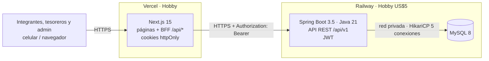
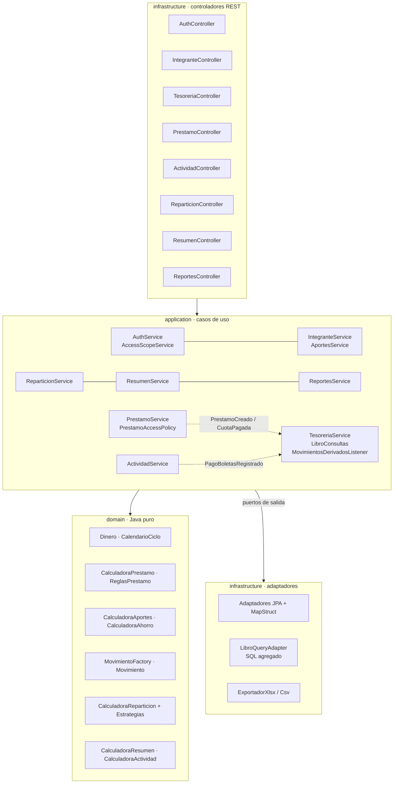
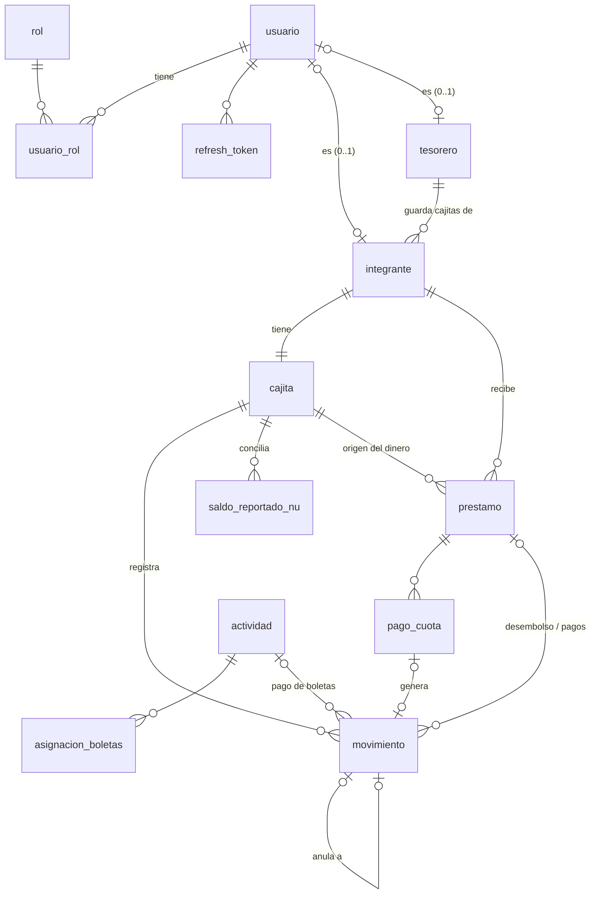
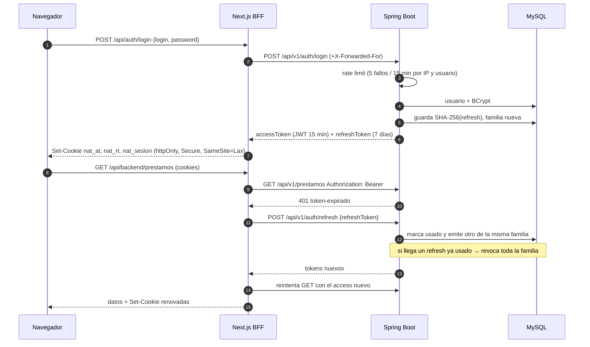

# Natillera Familiar — Documento de arquitectura

Este documento explica **lo que se construyó**: qué hace el sistema, cómo está organizado, qué patrones usa y por qué.
Todas las rutas son reales dentro del repositorio.

---

## 1. Resumen funcional

La natillera es un fondo de ahorro de 10 integrantes durante 12 meses. El sistema reemplaza el Excel
`Natillera_Familiar (1).xlsx` (hojas Configuración, Integrantes, Ahorros Mensuales, Tesorería, Préstamos, Actividades,
Repartición y Resumen) con las mismas fórmulas.

| Rol | Qué puede hacer |
|---|---|
| **INTEGRANTE** | "Mi cuenta": su cuota (y proponerla durante la inscripción), ahorro esperado vs. real por mes, atraso, saldo de su cajita, sus préstamos con plan de pagos, sus boletas, su repartición proyectada y real, su puesto. Exporta su estado de cuenta. |
| **TESORERO** (2) | Todo lo anterior + las cajitas de **sus** integrantes (saldos y conciliación con la app Nu), registrar movimientos, aportes del mes en lote, **todos** los préstamos (lectura), crear préstamos y registrar pagos cuando el dinero sale o entra de una cajita suya, cobrar boletas de sus integrantes, deudores y reportes de su alcance. |
| **ADMIN** | Todo: dashboard mensual/anual con KPIs y gráficas, configuración del ciclo y su estado (inscripción → activo → cerrado), usuarios y roles, integrantes y asignación de tesorero, rifas, tesorería global, repartición, reportes y auditoría. |

Un usuario puede tener varios roles (el admin y los tesoreros también ahorran).

---

## 2. Arquitectura

### 2.1 Contexto y contenedores



El navegador **nunca** ve el JWT ni la URL del backend: habla solo con Next.js (mismo dominio), que guarda los tokens en
cookies httpOnly y reenvía cada llamada al backend (patrón BFF). Así no hay cookies *cross-site* entre Vercel y Railway.

### 2.2 Componentes del backend (monolito modular hexagonal)



Cada módulo (`shared`, `auth`, `ciclo`, `integrantes`, `tesoreria`, `prestamos`, `actividades`, `reparticion`,
`resumen`, `reportes`) tiene `domain/` (sin Spring ni JPA), `application/` (casos de uso, puertos, DTOs internos) e
`infrastructure/` (REST, JPA, mappers). Los módulos se comunican por su capa `application` (p. ej. `PrestamoService`
usa `TesoreriaService.cajitaGestionable`) o por eventos de dominio.

**¿Por qué monolito modular y no microservicios?** Lo mantiene una sola persona, lo usan 10 familiares y debe caber en
US$5/mes. Un solo proceso y una sola base dan transacciones ACID entre préstamo y movimiento de dinero, un único
despliegue y un único healthcheck. Los límites de módulo y los puertos permiten extraer un módulo después si hiciera
falta, sin pagar hoy esa complejidad.

### 2.3 Frontend

- `src/app/(app)/**`: páginas por rol (layout de servidor que lee la sesión firmada y arma el menú).
- `src/app/api/auth/*` y `src/app/api/backend/[...ruta]`: BFF (login, logout, cambio de contraseña, proxy con refresh).
- `src/middleware.ts`: guarda de rutas por rol (`src/lib/rutas.ts`). Es solo experiencia de usuario; **la autorización
  real está en el backend**.
- TanStack Query (caché 30 s) + React Hook Form + Zod (`src/lib/esquemas.ts`); Recharts carga solo en el dashboard
  (`next/dynamic`).

---

## 3. Modelo de datos



| Tabla | Descripción |
|---|---|
| `usuario`, `rol`, `usuario_rol` | Usuarios (correo o celular, BCrypt 12, activo, cambio obligatorio) y relación N:M con roles. |
| `refresh_token` | Hash SHA-256 del refresh token, familia (UUID en `BINARY(16)`), expiración, usado/revocado. |
| `ciclo` | Configuración (hoja Configuración) y estado `INSCRIPCION / ACTIVO / CERRADO`. |
| `tesorero` | Dueño de una cuenta Nu. |
| `integrante` | Cuota mensual, teléfono, tesorero asignado, vínculo opcional con usuario. |
| `cajita` | Una por integrante. Su tesorero se deriva del integrante. |
| `movimiento` | **Libro único del dinero.** Entrada **o** salida (CHECK), tipo, referencias a préstamo/pago/actividad y `anula_a` para contramovimientos. Índices `(cajita_id, fecha)` y `(tipo)`. |
| `saldo_reportado_nu` | Saldo que muestra la app Nu en una fecha (conciliación). |
| `prestamo`, `pago_cuota` | Préstamo (monto, mes, cuotas, tasa, cajita origen) y pagos (índice único sobre una columna generada que vale NULL en los pagos anulados: una sola cuota vigente por número). |
| `actividad`, `asignacion_boletas` | Rifas y boletas por integrante cuando difieren del valor por defecto. |
| `auditoria` | Solo cambios sensibles: cuotas, tasas/configuración, anulaciones, roles, estado del ciclo. |

Los **aportes no tienen tabla**: se derivan de los movimientos `AHORRO`. El dinero es `DECIMAL(14,2)` y en Java
`BigDecimal` envuelto en el value object `Dinero`. Migraciones: `backend/src/main/resources/db/migration/V1__esquema.sql`
y seed `db/seed/V2__seed_dev.sql` (solo perfil `dev`).

---

## 4. Autenticación y autorización



- **JWT** HS256 (secreto ≥ 256 bits por `JWT_SECRET`), claims `sub`, `roles`, `integranteId`, `tesoreroId`, `pwdChange`.
  `backend/src/main/java/co/natillera/auth/infrastructure/security/JwtTokenProvider.java`.
- **Cambio de contraseña obligatorio**: con `pwdChange=true` el filtro solo deja usar `/auth/cambiar-password`, `/me`
  y `/logout` (`JwtAuthenticationFilter`).
- **Alcances** (`AccessScopeService`, bean `@access`): `OWN` (integrante), `ASSIGNED` (tesorero: sus integrantes),
  `ALL` (admin). Cada caso de uso pide `exigirVerIntegrante` / `exigirGestionarIntegrante` o filtra con
  `integrantesVisibles()`. Un recurso que existe pero está fuera de alcance responde **404** (IDOR); si se ve pero no se
  administra (integrante sobre su propia cajita), **403**. Los permisos por rol van con `@PreAuthorize`.
- **Préstamos**: la regla "el tesorero ve todos los préstamos" está aislada en
  `prestamos/application/PrestamoAccessPolicy.java`.
- **CSRF**: cookies `SameSite=Lax` + verificación de `Origin` en las mutaciones del BFF (`src/lib/bff.ts`).
- **CORS** en el backend: solo `CORS_ALLOWED_ORIGIN`. Headers HSTS, `nosniff`, `frame-ancestors 'none'` en Spring y
  en `next.config.mjs` (además CSP).

---

## 5. Patrones de diseño

| Patrón | Problema que resuelve | Dónde |
|---|---|---|
| **Strategy** | Intereses y rifas se reparten con reglas distintas | `reparticion/domain/EstrategiaReparto.java`, `RepartoProporcionalAlAhorro.java`, `RepartoIgualitario.java` |
| **Ports & Adapters / Repository** | El dominio y los casos de uso no dependen de JPA ni SQL | Puertos en `*/application/port/out/*Port.java`; adaptadores en `*/infrastructure/persistence/*Adapter.java` |
| **Factory** | Los movimientos derivados (desembolso, pago de cuota, boletas, anulación) se construyen siempre igual | `tesoreria/domain/MovimientoFactory.java` |
| **Domain Events** | Préstamos y rifas no conocen la tesorería; el dinero se registra en la misma transacción | `prestamos/domain/evento/*`, `actividades/domain/evento/PagoBoletasRegistrado.java`, `tesoreria/application/MovimientosDerivadosListener.java` |
| **Specification / Policy** | Validaciones encadenables y políticas de acceso aisladas | `prestamos/domain/regla/ReglaPrestamo.java`, `ReglasPrestamo.java`, `auth/application/AccessScopeService.java`, `PrestamoAccessPolicy.java` |
| **Value Object** | Nunca `double` para dinero; redondeo explícito | `shared/domain/Dinero.java` |
| **DTO + Mapper (MapStruct)** | Entidades JPA ↔ dominio ↔ JSON | `*/infrastructure/persistence/*Mapper.java`, `shared/infrastructure/persistence/DineroMapeo.java`, records `*Dto` en controladores |
| **Template Method** | Mismo algoritmo de exportación para Excel y CSV | `reportes/infrastructure/export/ExportadorReporte.java`, `ExportadorXlsx.java`, `ExportadorCsv.java` |
| **Manejo centralizado de errores (RFC 7807)** | Errores uniformes en español | `shared/infrastructure/web/ManejadorErrores.java`, `auth/infrastructure/security/RespuestaProblema.java` |
| **BFF** | Tokens fuera del alcance de JavaScript | `frontend/src/app/api/backend/[...ruta]/route.ts`, `frontend/src/lib/bff.ts` |

Fragmentos:

```java
// Strategy — reparticion/domain/CalculadoraReparticion.java
public static CalculadoraReparticion porDefecto() {
    return new CalculadoraReparticion(new RepartoProporcionalAlAhorro(), new RepartoIgualitario());
}
```

```java
// Specification encadenable — prestamos/domain/regla/ReglasPrestamo.java
public static ReglaPrestamo cadenaPorDefecto() {
    return MONTO_POSITIVO.y(INTEGRANTE_ACTIVO).y(CUOTAS_POSITIVAS).y(MAXIMO_CUOTAS)
            .y(MES_VALIDO).y(FIN_DEL_CICLO).y(SALDO_CAJITA);
}
```

```java
// Domain Event — prestamos/application/PrestamoService.java  →  tesoreria/application/MovimientosDerivadosListener.java
eventos.publishEvent(new PrestamoCreado(guardado.id(), guardado.cajitaOrigenId(), guardado.fechaDesembolso(),
        guardado.monto(), nombre));
// ...
@EventListener
public void alCrearPrestamo(PrestamoCreado e) {
    tesoreria.registrarDerivado(MovimientoFactory.desembolsoPrestamo(e.cajitaOrigenId(), e.fecha(), e.prestamoId(),
            e.nombreIntegrante(), e.monto()));
}
```

```java
// Template Method — reportes/infrastructure/export/ExportadorReporte.java
public final byte[] exportar(Reporte reporte) {
    iniciar(reporte);
    for (Reporte.Tabla tabla : reporte.tablas()) {
        iniciarTabla(reporte, tabla); escribirEncabezados(tabla.columnas());
        for (List<Object> fila : tabla.filas()) escribirFila(tabla.columnas(), fila);
        finalizarTabla(tabla);
    }
    finalizar(salida); ...
}
```

---

## 6. Lógica de negocio: equivalencia Excel → código

| Hoja / columna del Excel | Clase / método |
|---|---|
| Configuración!B12 `EDATE(B6,B7-1)` | `Ciclo.fechaCierre()` |
| Configuración!B17 `(1+B16)^(1/12)-1` | `Ciclo.tasaMensualNu()` |
| Ahorros Mensuales!T3 meses transcurridos | `CalendarioCiclo.mesesTranscurridos()` |
| Tesorería!H mes `(YEAR-YEAR)*12+MONTH-MONTH+1` | `CalendarioCiclo.mesDelCiclo()` |
| Integrantes!E ahorro esperado · F % del total | `CalculadoraAhorro.ahorroEsperado()` · `porcentajeDelTotal()` |
| Integrantes!I `"Natillera - "&B` | `Integrante.nombreCajitaPorDefecto()` |
| Integrantes!J rendimiento proyectado | `CalculadoraAhorro.rendimientoProyectadoCajita()` |
| Ahorros Mensuales (matriz, total, diferencia, % cumplimiento, atraso, totales y acumulados) | `CalculadoraAportes.estado()`, `totalesPorMes()`; datos: `LibroQueryAdapter.aportesPorIntegranteYMes()` |
| Tesorería!D/E/F entradas, salidas, saldo por cajita | `SaldoCajita.saldo()`; SQL `LibroQueryAdapter.saldosCajitas()` |
| Tesorería!H diferencia con la app (`IF(G="",0,G-F)`) | `Conciliacion.diferencia()` |
| Tesorería tablas por tesorero, por tipo y por mes (saldo acumulado) | `CalculadoraTesoreria.porTesorero()`, `porMes()`; `LibroQueryAdapter.totalesPorTipo()` |
| Préstamos!H, I, J, K, L | `CalculadoraPrestamo.interesPorCuota()`, `abonoCapitalPorCuota()`, `valorCuota()`, `totalIntereses()`, `totalAPagar()` |
| Préstamos!N, O, P (intereses recibidos, saldo, estado) | `CalculadoraPrestamo.resumir()` |
| Préstamos!P advertencias "más de 12 cuotas" / "termina después del cierre" | `ReglasPrestamo.MAXIMO_CUOTAS`, `FIN_DEL_CICLO` (ahora **bloquean**) |
| Préstamos!R:AC proyección de intereses | `CalculadoraPrestamo.proyeccionIntereses()` / `interesDelMes()` |
| Actividades (mes, valor a pagar, pagado, pendiente, recaudos, costos, utilidades, por integrante) | `CalculadoraActividad.resumir()`, `porIntegrante()` |
| Repartición B5:C9 conceptos | `CalculadoraReparticion.conceptos()` |
| Repartición filas (participación, intereses, actividades, rendimiento, total, RANK) | `CalculadoraReparticion.calcular()`, `Ranking.puesto()` |
| Resumen C:K (flujo, caja acumulada, fondo total) | `CalculadoraResumen.calcular()`; KPIs en `ResumenService` |

Los casos de referencia de la sección 3.9 están en `backend/src/test/java/co/natillera/golden/GoldenExcelTest.java`.

---

## 7. Decisiones técnicas (ADR breves)

1. **Libro de movimientos como fuente única de verdad.** Aportes, saldos de cajitas, pagos de boletas y rendimientos se
   calculan desde `movimiento`. *Consecuencia:* no hay datos duplicados que se desincronicen; los reportes se calculan con
   SQL agregado. Los movimientos **no se borran**: se anulan con un contramovimiento del mismo tipo con el lado invertido
   (`anula_a`, motivo y auditoría); por eso el aporte de un mes es `Σ(entrada − salida)` de `AHORRO`.
2. **BigDecimal y redondeo.** Todo el dinero es `Dinero` (BigDecimal, divisiones a 10 decimales, HALF_UP). Se redondea a
   centavos al persistir/serializar y a pesos al mostrar (`Intl.NumberFormat('es-CO', … COP, 0 decimales)`). La única
   cuenta en `double` es la tasa mensual Nu (`Math.pow`), convertida con `MathContext.DECIMAL64`.
3. **Ajuste de la última cuota.** El resumen del préstamo conserva las fórmulas exactas del Excel (abono
   166.666,67; saldo 983.333,33 en el golden test). El **plan de pagos** —lo que se cobra— redondea cada cuota al peso y
   pone el residuo del capital en la última (166.667 × 5 + 166.665 = 1.000.000). Al pagar todas las cuotas, el saldo es
   exactamente 0.
4. **Bloqueo de préstamos posteriores al cierre.** El Excel solo advertía; aquí se rechaza con 422, configurable con
   `permitirPrestamoDespuesDelCierre`. También se rechaza un monto mayor al saldo de la cajita de origen.
5. **BFF con cookies httpOnly.** Evita exponer el JWT a JavaScript (XSS) y los problemas de cookies de terceros entre
   Vercel y Railway. El middleware usa una cookie de sesión *firmada* (rol y estado), nunca el JWT.
6. **Tesorero ve todos los préstamos** (supuesto del prompt), aislado en `PrestamoAccessPolicy`.
7. **Aportes en lote todo-o-nada.** Primero se valida el alcance de cada integrante; solo después se guarda.
8. **Caché del ciclo en memoria** (`CicloService`): se lee en casi todos los casos de uso; se invalida al actualizar y
   otra vez al terminar la transacción (por si se revierte). Válido porque se despliega una sola instancia.
9. **Fecha de negocio simulada** (`FECHA_SIMULADA`, solo dev) separada del reloj real de los tokens.

---

## 8. Optimización de recursos (con mediciones reales)

| Ajuste | Dónde |
|---|---|
| `-Xmx256m -Xss512k -XX:+UseSerialGC -XX:MaxMetaspaceSize=128m -XX:+ExitOnOutOfMemoryError -XX:TieredStopAtLevel=1` | `backend/Dockerfile` (`JAVA_TOOL_OPTIONS`) |
| Jar extraído (`-Djarmode=tools extract`) + **CDS** (`-XX:SharedArchiveFile`) entrenado en el build sin base de datos | `backend/Dockerfile`, etapa `cds` |
| Hilos virtuales, Tomcat `threads.max=20`, Hikari `5 / min-idle 1 / idle 60 s`, `open-in-view=false`, `ddl-auto=validate` | `application.yml` |
| `lazy-initialization=true` en prod, logs JSON (logstash encoder), Actuator solo `health` | `application-prod.yml`, `logback-spring.xml` |
| Sin `@Scheduled`: compatible con *app sleeping* de Railway | — |
| Reportes con SQL agregado (`GROUP BY`) y proyección a records; sin N+1 verificado por prueba | `LibroQueryAdapter`, `RendimientoIT` |

**Trade-off de `TieredStopAtLevel=1`:** solo usa el compilador C1. Arranca y calienta más rápido y usa menos memoria de
código, a cambio de ~10–30 % menos rendimiento pico; con 10 usuarios el pico nunca importa y el arranque en frío sí
(app sleeping).

Mediciones en una laptop Intel Core i5-8250U (Windows 11, JDK 21.0.7), base PostgreSQL 16 local:

| Escenario | Tiempo hasta contexto listo |
|---|---|
| Fat jar, perfil dev (con seed y Swagger) | 27,4 s (`Started … in 27.429 s`) |
| Fat jar, perfil prod | 24,4 s |
| Jar extraído, perfil prod, sin CDS | 13,2 s |
| **Jar extraído + CDS** (entrenado con base) | **7,2 s** |
| **Jar extraído + CDS entrenado sin base** (lo que hace el Dockerfile) | **8,8 s** |

Memoria residente del proceso en reposo tras atender peticiones (fat jar, flags de producción): **≈ 301 MB** (< 400 MB).
Latencia de reportes con el seed (40 peticiones, MockMvc + PostgreSQL): p95 entre 11 ms y 98 ms
(ver [test.md](test.md)). En Railway (CPU de servidor) los tiempos deberían ser menores; el Dockerfile no se pudo
construir en esta máquina (sin Docker), así que la cifra de Railway queda por medir en el primer despliegue.

Frontend: páginas dinámicas livianas (≈ 103 kB de JS compartido); Recharts solo se descarga en el dashboard; ilustración en
SVG; sin pagos ni publicidad (Vercel Hobby es para uso no comercial).

---

## 9. Despliegue y operación

**Railway (backend + MySQL):** servicio con Root Directory `backend` (usa `Dockerfile` y `railway.json`),
variables `DATABASE_URL=${{MySQL.MYSQL_URL}}` (red privada), `JWT_SECRET`, `CORS_ALLOWED_ORIGIN`,
`FRONTEND_URL`, `SPRING_PROFILES_ACTIVE=prod`. Backups habilitados en el servicio de MySQL.

**Vercel (frontend):** Root Directory `frontend`, variables `BACKEND_URL`, `SESSION_SECRET`, `COOKIE_SECURE=true`.

**Primer administrador en producción** (el seed solo corre en dev). Genere el hash y ejecute en la consola de MySQL:

```bash
htpasswd -bnBC 12 "" 'ClaveTemporal2027' | tr -d ':\n'   # o cualquier generador BCrypt cost 12
```

```sql
INSERT INTO usuario (nombre, correo, password_hash, debe_cambiar_password) VALUES ('Administrador', 'admin@sudominio.co', '<hash>', TRUE);
INSERT INTO usuario_rol (usuario_id, rol_id) SELECT id, 1 FROM usuario WHERE correo = 'admin@sudominio.co';
```

Después todo se gestiona desde la web (usuarios, tesoreros, integrantes, ciclo).

**Rotación de `JWT_SECRET`:** cambiar la variable y redeploy. Los access tokens vigentes dejan de validar (máx. 15 min);
el BFF refresca con el refresh token (opaco, no depende del secreto), así que nadie pierde la sesión.
Para expulsar a todos, además: `UPDATE refresh_token SET revocado = true;`.

**Cierre del ciclo e inicio de uno nuevo:** (1) registrar las entregas finales (`RETIRO_ENTREGA_FINAL`) y exportar los
reportes a Excel; (2) `Configuración → Cerrar ciclo` (queda en auditoría; se bloquean préstamos y rifas); (3) respaldo
de la base (Railway Backups); (4) para el nuevo ciclo, restaurar una base vacía con las migraciones o limpiar
movimientos, préstamos y actividades y actualizar la configuración. El soporte nativo de varios ciclos es una mejora
futura.

---

## 10. Limitaciones conocidas y mejoras futuras

- Un solo ciclo activo por base de datos (no hay historial de ciclos).
- El rate limit de login y la caché del ciclo son en memoria: correctos para una instancia; con varias se necesitaría
  Redis o Bucket4j distribuido.
- El seed de dev inserta el préstamo de ejemplo directamente (sin las reglas): la cajita de origen no habría tenido saldo
  suficiente en febrero.
- No se registran pagos parciales de cuotas (una cuota = un pago, anulable).
- El Dockerfile y el `docker compose` no se probaron en esta máquina (sin Docker); el backend, los jar extraídos con CDS,
  las pruebas y el frontend sí se ejecutaron.
- Mejoras: notificaciones por WhatsApp de cuotas vencidas y atrasos, soporte de varios ciclos, PWA instalable con
  modo sin conexión, carga de comprobantes de pago, recordatorio de conciliación mensual con Nu.
